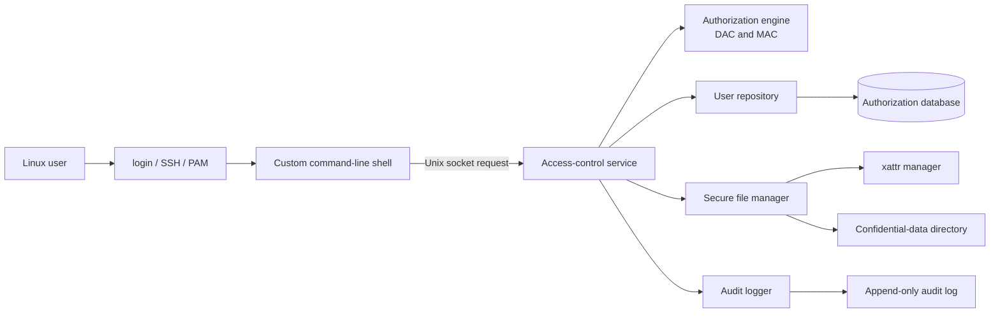

# Security Access System Architecture

## 1. Scope and mandatory requirements

This document defines the first-phase architecture for a Linux (Ubuntu) system
that controls access to confidential files. The implementation language will be
Python 3, the user interface will be a custom command-line shell, file metadata
will use Linux extended attributes (xattr), and tests will use pytest.

The following are mandatory assignment requirements:

- User management: add, edit, remove, list users, assign permissions, and assign confidentiality levels.
- File management: create, read, edit, delete, list files, and display attributes.
- DAC permissions: `READ`, `WRITE`, `CREATE`, `DELETE`, and user-management permissions.
- MAC labels: `low_secret < secret < top_secret`, with no read up and no write down.
- The prescribed DAC/MAC decision rule: use DAC for equal user and file labels; use MAC for different labels; for a missing target, use DAC to decide whether creation is allowed.
- Operating-system authentication before the custom shell starts.
- Audit logging of successful and denied actions.
- File operations confined to a protected confidential-data directory, including protection against traversal and symlink escape.

The service boundary described below is an architectural recommendation. It makes
the required access checks meaningful even when a user tries to bypass the Python
shell and access the filesystem directly.

## 2. Overall architecture

The system has a small unprivileged client and a protected access-control service.
The custom shell does not open confidential files itself. It sends validated command
requests over a local Unix domain socket to the service. The service is the only
account allowed to read or modify the confidential-data directory and its labels.



### Trust boundaries

1. **Linux authentication boundary:** PAM authenticates the operating-system account before the shell is launched.
2. **Client/service boundary:** the service obtains the Unix peer UID from the socket; the client-supplied username is never trusted.
3. **Filesystem boundary:** only the service account can access confidential data and write security xattrs.
4. **Administrative boundary:** user-management commands require explicit user-management permissions and should be limited to approved Linux administrators.

## 3. Project structure

```text
Authentification/
├── README.md
├── docs/
│   └── ARCHITECTURE.md
├── pyproject.toml
├── src/
│   └── security_access/
│       ├── __init__.py
│       ├── cli.py
│       ├── service.py
│       ├── configuration.py
│       ├── authentication.py
│       ├── authorization.py
│       ├── models.py
│       ├── user_repository.py
│       ├── user_management.py
│       ├── file_management.py
│       ├── path_guard.py
│       ├── xattr_manager.py
│       ├── audit_log.py
│       └── errors.py
├── tests/
│   ├── unit/
│   ├── integration/
│   └── conftest.py
├── systemd/
│   └── security-access.service
└── config/
    └── security-access.example.toml
```

Only `README.md` and this architecture document are created in the first phase.
The other entries specify the planned implementation layout.

## 4. Modules and interactions

| Module | Responsibility | Depends on |
| --- | --- | --- |
| `cli.py` | Parses shell commands, displays results, and talks to the local service. | `models` |
| `authentication.py` | Maps authenticated Linux UID to the application identity and validates the peer identity. It never asks for a password. | `user_repository`, `audit_log` |
| `service.py` | Owns the Unix socket, dispatches requests, and orchestrates authorization and execution. | all domain modules |
| `authorization.py` | Implements the required DAC/MAC selection and decisions. | `models` |
| `user_repository.py` | Reads and writes protected authorization records. | `configuration`, `models` |
| `user_management.py` | Applies authorization and validation for user administration. | `authorization`, `user_repository`, `audit_log` |
| `file_management.py` | Performs secure file operations only after authorization. | `path_guard`, `xattr_manager`, `audit_log` |
| `path_guard.py` | Resolves safe relative names and opens paths without traversal or symlink escape. | `configuration` |
| `xattr_manager.py` | Reads and writes owner and confidentiality xattrs. | `models` |
| `audit_log.py` | Emits structured, append-only audit records. | `configuration` |
| `configuration.py` | Loads non-secret paths, socket path, and logging settings. | none |
| `models.py` | Defines immutable request, user, file-metadata, decision, and log-event models. | none |

Dependencies point inward: the CLI only knows request and response models; it
does not call filesystem code, authorization code, or repositories directly.

## 5. Data models

### User record

```text
User
  username: string, unique and matching the mapped Linux account
  linux_uid: integer, unique
  confidentiality_level: low_secret | secret | top_secret
  permissions: set[READ, WRITE, CREATE, DELETE, MANAGE_USERS]
  active: boolean
  created_at: UTC timestamp
  updated_at: UTC timestamp
```

The authorization database should be owned by the service account and readable
only by that account. SQLite is sufficient for this assignment because the data
is local and small; parameterized queries are required.

### File metadata

```text
FileMetadata
  relative_path: safe path below the confidential-data root
  owner: username
  confidentiality_level: low_secret | secret | top_secret
```

Store metadata with names in a private xattr namespace, for example
`user.security_access.owner` and `user.security_access.label`. The service must
set both attributes atomically as far as the filesystem permits and reject a file
whose required attributes are absent or invalid.

### Audit event

```text
AuditEvent
  timestamp: UTC ISO-8601 timestamp
  username: authenticated username
  operation: LOGIN | LOGOUT | CREATE | READ | WRITE | DELETE | LIST | SHOW_ATTRIBUTES | USER_CREATE | USER_EDIT | USER_DELETE
  target: normalized relative resource name or user name
  result: SUCCESS | DENIED
  reason: stable decision code
```

## 6. Authentication design

The custom shell must start only after operating-system authentication. A suitable
Ubuntu design is a dedicated Linux account for each application user, authenticated
through PAM by `login` on a local terminal or by `sshd` for SSH. Each account has
the custom shell or a small launcher configured as its login shell. PAM validates
the password using the Linux account store, then starts the launcher, which opens
the custom shell.

The custom shell connects to the local service. The service reads the peer UID
with `SO_PEERCRED` and maps it to a `User` record. It does not accept a username
from command input as proof of identity.

The requirement for a dedicated user store and securely hashed passwords is
ambiguous when OS authentication is also mandatory. The recommended design uses
Linux/PAM as the password authority, with password hashes protected in the normal
Linux account database, while the application's dedicated SQLite store contains
authorization data only. Duplicating password hashes in SQLite creates a second
credential store and a synchronization risk. This interpretation should be
confirmed with the instructor if a separate application password hash is required.

## 7. Authorization algorithms

### Common checks

```text
authorize(request, user, target_metadata):
    require user.active
    validate operation and normalized relative path
    if request targets user administration:
        return DAC(user, MANAGE_USERS)
    if target does not exist:
        return DAC(user, CREATE)
    if user.confidentiality_level == target_metadata.confidentiality_level:
        return DAC(user, permission_for(request.operation))
    return MAC(user, target_metadata, request.operation)
```

### DAC

```text
DAC(user, required_permission):
    if required_permission is in user.permissions:
        allow
    otherwise:
        deny with DAC_PERMISSION_MISSING
```

### MAC

```text
MAC(user, file, operation):
    user_rank = rank(user.confidentiality_level)
    file_rank = rank(file.confidentiality_level)

    if operation is READ and user_rank < file_rank:
        deny with MAC_NO_READ_UP
    if operation is WRITE and user_rank > file_rank:
        deny with MAC_NO_WRITE_DOWN
    otherwise:
        allow
```

The assignment explicitly requires DAC only for equal labels and MAC only for
different labels. Therefore the system must not add an extra DAC permission check
to a differing-label decision unless the instructor changes that rule.

For a new file, DAC authorizes `CREATE`. Its initial confidentiality label must
be stated by the request and validated against the assignment's creation policy;
the assignment does not define that policy. A safe proposed default is to allow
creation at the creator's own label only. This is an open requirement to confirm.

## 8. Access request workflow

1. The user authenticates through Linux PAM using local login or SSH.
2. PAM starts the configured custom shell after successful authentication.
3. The shell connects to the service's Unix socket and submits a parsed command.
4. The service obtains the peer UID and loads the matching active user record.
5. The path guard validates a relative path and safely resolves it under the confidential-data root.
6. The service loads xattr metadata if the target exists.
7. The authorization engine applies the required DAC/MAC selection rule.
8. The service records an access attempt and its authorization decision.
9. If authorized, the secure file or user-management module performs the operation.
10. The service records the final `SUCCESS` or `DENIED` result and returns a response to the shell.

Login and logout events are recorded by the launcher or service session handler.
Each denied request is logged without exposing confidential file content.

## 9. Security risks and mitigations

| Risk | Mitigation |
| --- | --- |
| Password theft or weak hashing | Use PAM/Linux password management; never store plaintext passwords or log them. |
| Shell client impersonation | Bind identity to Unix peer credentials, not a supplied username. |
| Direct filesystem bypass | Make the confidential-data directory and xattrs owned by the service account; deny direct user access with Linux permissions. |
| `../` traversal | Accept only normalized relative paths; reject absolute paths and any resolved path outside the root. |
| Symlink escape | Reject symlinks in every path component and use descriptor-based operations with `O_NOFOLLOW` where available. |
| Metadata tampering | Restrict xattr writes to the service account; verify metadata before each operation. |
| Time-of-check/time-of-use race | Resolve and operate through trusted directory descriptors rather than checking a string then reopening it. |
| SQL injection | Use parameterized SQLite queries and strict input validation. |
| Audit-log tampering | Use root/service-only write permissions, append-only rotation, and optionally forward copies to journald. |
| Sensitive error disclosure | Return stable error codes to the user; keep detailed diagnostics only in protected logs. |

Python checks alone cannot prevent a user who has OS-level write permission from
editing a file or its xattrs. The service-owned directory and Unix permissions are
therefore part of the security design, not optional hardening.

## 10. Development roadmap

1. Confirm the two open policies: new-file label selection and whether password hashes must be duplicated outside PAM.
2. Create the package layout, configuration schema, models, and error types.
3. Provision the service account, protected data directory, Unix socket, and systemd unit in a test VM.
4. Implement the user repository and validated user-administration operations.
5. Implement xattr metadata handling and descriptor-based safe path operations.
6. Implement DAC, MAC, and the exact decision selector with unit tests.
7. Implement file operations and structured audit logging.
8. Implement the custom shell and PAM/login-shell integration.
9. Run integration and adversarial tests in an Ubuntu VM.
10. Document installation, operational limits, and test evidence.

## 11. Testing strategy

### Unit tests

- Confidentiality ordering, no-read-up, and no-write-down decisions.
- Equal-label DAC and different-label MAC selection.
- Missing-target `CREATE` DAC decision.
- Permission mapping for every command and user-management action.
- Username, label, and command input validation.
- Path normalization, absolute path rejection, traversal rejection, and symlink rejection.
- xattr encoding, missing attributes, and invalid labels.
- Audit-event schema and redaction of file content.

### Integration tests

- A temporary protected directory, xattrs, and SQLite authorization store.
- Allowed and denied file operations for every label pair.
- User creation, update, deletion, and permission changes.
- A real Unix socket request proving that the service uses peer UID rather than a claimed username.
- Attempts using `../`, absolute paths, nested symlinks, and replace-after-check races.
- Log records for login/logout, attempts, successes, and denials.
- Ubuntu VM checks for service-account directory permissions and the PAM/login-shell launch path.

Tests must be isolated with temporary directories and databases. Tests must never
use a real confidential-data directory or production credentials.
